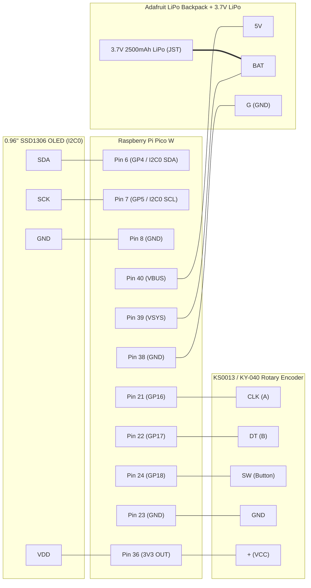

# Hardware Wiring & Pinout Schematic

This document details the wiring architecture for the Raspberry Pi Pico W Baby Buddy Bottle Logger. The layout groups connections into physical board corners to keep DuPont jumper routing clean inside the enclosure.

## 1. Visual Architecture (Mermaid)

GitHub natively renders the Mermaid block below into a visual schematic:



## 2. ASCII Board Pinout & Schematic

```text
                        +---------[ USB ]---------+
                   GP0  | [ 1]               [40] | VBUS <---- [Backpack 5V]
                   GP1  | [ 2]               [39] | VSYS <---- [Backpack BAT]
                   GND  | [ 3]               [38] | GND  <---- [Backpack G]
                   GP2  | [ 4]               [37] | 3V3_EN
                    GP3  | [ 5]               [36] | 3V3(OUT) -+--> [OLED VDD]
                                                            `--> [ENC +]
    [OLED SDA] <--> GP4  | [ 6]  TOP-LEFT     [35] | ADC_VREF  |
    [OLED SCK] <--> GP5  | [ 7]  (OLED)       [34] | GP28
   [OLED GND] <--- GND  | [ 8]               [33] | GND (AGND)
                   GP6  | [ 9]               [32] | GP27
                   GP7  | [10]               [31] | GP26
                   GP8  | [11]               [30] | RUN
                   GP9  | [12]  RASPBERRY    [29] | GP22
                   GND  | [13]  PI PICO W    [28] | GND
                  GP10  | [14]               [27] | GP21
                  GP11  | [15]               [26] | GP20
                  GP12  | [16]               [25] | GP19
                  GP13  | [17]               [24] | GP18 <---- [ENC SW]
                   GND  | [18]  BTM-RIGHT    [23] | GND  <---- [ENC GND]
                  GP14  | [19]  (ENCODER)    [22] | GP17 <---- [ENC DT]
                  GP15  | [20]               [21] | GP16 <---- [ENC CLK]
                        +-------------------------+
```

## 3. Master Pinout Reference Table

### A. 0.96" SSD1306 I2C OLED Display (Top-Left Corner)
| Component Pin | Pico W GPIO | Physical Pin | Signal / Function |
| :--- | :--- | :--- | :--- |
| **GND** | `GND` | Pin 8 | Ground |
| **VDD** | `3V3(OUT)` | Pin 36 | 3.3V Logic Power (shared with Encoder `+`) |
| **SCK** | `GP5` | Pin 7 | `I2C0 SCL` (Clock) |
| **SDA** | `GP4` | Pin 6 | `I2C0 SDA` (Data) |

### B. KS0013 / KY-040 Rotary Encoder (Bottom-Right Corner)
| Component Pin | Pico W GPIO | Physical Pin | Signal / Function |
| :--- | :--- | :--- | :--- |
| **CLK** | `GP16` | Pin 21 | Quadrature Phase A (Interrupt-driven) |
| **DT** | `GP17` | Pin 22 | Quadrature Phase B (Direction sense) |
| **GND** | `GND` | Pin 23 | Ground |
| **SW** | `GP18` | Pin 24 | Pushbutton Switch (Active-Low w/ internal pull-up) |
| **+** (VCC) | `3V3(OUT)` | Pin 36 | 3.3V Pull-up Reference (shared with OLED `VDD`) |

### C. Adafruit LiIon/LiPoly Backpack (#2124) & Battery (Top-Right Corner)
| Component Pin | Pico W GPIO | Physical Pin | Signal / Function |
| :--- | :--- | :--- | :--- |
| **5V** | `VBUS` | Pin 40 | 5V USB input from Pico to charge LiPo when plugged in |
| **BAT** | `VSYS` | Pin 39 | 3.7V–4.2V battery output to power Pico when unplugged |
| **G** | `GND` | Pin 38 | Common Ground |
| **JST 2-Pin** | — | — | Connects directly to 3.7V 2500mAh LiPo pouch (#328) |


## 4. Assembly & Wiring Notes

- **3.3V Power Sharing (`Pin 36`):** Because the Pico W has a single `3V3(OUT)` header pin (`Pin 36`), use a 1-to-2 female DuPont Y-splitter jumper (or splice two female jumper leads together) to feed `3.3V` to both the OLED `VDD` and the KS0013 `+` pin.
- **Encoder Direction Inversion:** If rotating the knob clockwise decreases the ounce value, swap the DuPont jumpers on **Pin 21 (`GP16`)** and **Pin 22 (`GP17`)**, or swap `ENC_CLK_PIN` and `ENC_DT_PIN` in `main.py`[cite: 1, 2].
- **Schottky Diode Protection (When Using LiPo Backpack):** If plugging into USB while the LiPo is connected to `VSYS`, ensure a Schottky diode (such as a `1N5817` or `MBR120`) is placed inline between the Backpack `BAT` pin and Pico `VSYS` (`Pin 39`)—anode to `BAT`, cathode (striped end) to `VSYS`—per Raspberry Pi Pico W datasheet guidelines so `VBUS` (5V) does not back-feed directly into the battery prior to the charger circuit.
